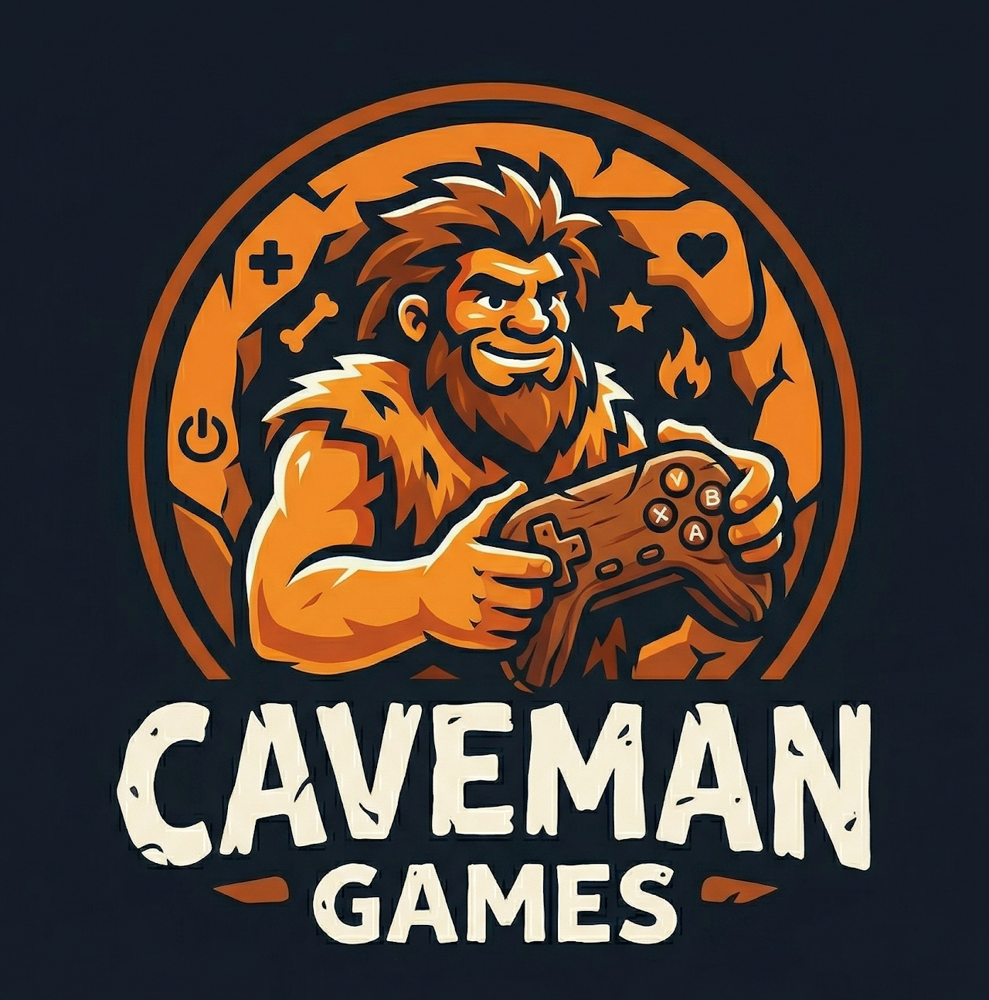

# Enshrouded Server Manager

A lightweight, user-friendly Windows desktop utility built with **Flutter** by **Caveman Games**. Designed to effortlessly configure world settings, manage player limits, configure access passwords, and control your Enshrouded dedicated server process without messing with raw JSON files.

---

## ⚠️ Important Prerequisite (Read First!)
Before using this manager, **you must start your Enshrouded dedicated server at least once**. 
When you run the server for the first time, it generates the required `enshrouded_server.exe` and the initial `enshrouded_server.json` configuration file. This manager relies on editing that configuration file!

---

## Key Features

- **Interactive UI Sliders:** Tweak enemy damage/health, player stats, survival mechanics, and resource multipliers using precise percentage steps.
- **User Groups & Passwords:** Easily manage access roles (Admin, Friend, Guest, Visitor) and individual permissions.
- **Smart Path Detection:** 
  - **Automatic:** The app automatically scans standard Steam/SteamCMD installation paths (`C:\steamcmd\...` or `C:\Program Files (x86)\Steam\...`).
  - **Manual:** If your server is installed in a custom directory, simply use the built-in folder picker to select your `enshrouded_server.exe`.
- **Live Console Output:** Start and stop your server process directly from the app and monitor real-time server logs.

---

## How to Use

1. Download the latest `.zip` release from the [Releases page](https://github.com/caveman-games/cavemangames/releases/tag/v1.0.0).
2. Extract the files to a folder on your computer.
3. Ensure you have run your Enshrouded server at least once so the configuration files exist.
4. Launch `enshrouded_manager.exe`.
5. If the server isn't found automatically, click **Select Server Map / Path** and point it to your `enshrouded_server.exe`.
6. Customize your settings across the tabs and hit **Save**.

---

## Credits

Developed with passion by **[Caveman Games](https://caveman-games.github.io/cavemangames/)**. 

If you like this utility and want to support future open-source tools and indie games, consider buying us a coffee!

